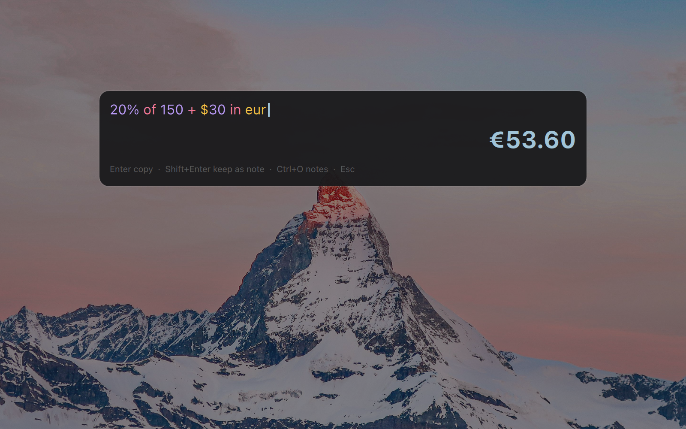

# numr for Omarchy

A Spotlight-style calculator for the Omarchy Quattro shell, powered by
[numr](https://github.com/nasedkinpv/numr). Press a key, type
`20% of 150 + $30 in eur`, read the answer. Enter copies it. Shift+Enter keeps
the line in your numr notes, the same `default.numr` document the `numr` TUI
opens, so variables you define there work here and vice versa.



Everything runs inside the long-lived `omarchy-shell` process. There is no
second Quickshell instance; one `numr-cli --server` is started on first use and
answers every keystroke over JSON-RPC.

## Requirements

- Omarchy Quattro 4.0.3 or later (Hyprland session)
- `numr-cli` 0.9 or later in `PATH`. On Arch: `yay -S numr-bin` (or `numr`)
- `wl-copy` from `wl-clipboard`, which Omarchy installs by default

No sudo or pkexec is required. The plugin never touches system files.

## Install

```bash
omarchy plugin add https://github.com/nasedkinpv/omarchy-numr.git --enable
```

`--enable` puts a small 󰃬 button in the bar's right section. The calculator
itself is an overlay you can open from anywhere:

```bash
omarchy-shell shell toggle io.github.nasedkinpv.numr '{}'
```

### Keybinding

Omarchy binds the stock `omacalc` calculator to `SUPER + SHIFT + Q` and the
`XF86Calculator` key. To hand those keys to numr, add to
`~/.config/hypr/bindings.lua`:

```lua
hl.unbind("SUPER + SHIFT + Q")
hl.unbind("XF86Calculator")
o.bind("SUPER + SHIFT + Q", "numr calculator", "omarchy-shell shell toggle io.github.nasedkinpv.numr '{}'")
o.bind("XF86Calculator", "numr calculator", "omarchy-shell shell toggle io.github.nasedkinpv.numr '{}'")
```

Any other chord works the same way; the plugin does not edit your Hyprland
configuration for you.

### Omarchy menu entry

To reach it from the Omarchy menu (`SUPER + SPACE`, type `calc`, Enter), add
a row to `~/.config/omarchy/extensions/omarchy-menu.jsonc`:

```jsonc
"numr": {"icon":"󰃬","label":"Calculator","description":"numr · units, currencies, variables","action":"omarchy-shell shell toggle io.github.nasedkinpv.numr '{}'"},
```

The stock menu cannot evaluate what you type into its own search field: its
rows come from JSONC and a fixed set of providers, with no hook for live
results. Plugins that show answers inside the menu ship a modified copy of
`Menu.qml`, which stops tracking Omarchy updates. This plugin keeps the menu
untouched and gives the calculator its own key instead, the way Spotlight has
its own.

### Prefill from a script

The summon payload accepts an expression:

```bash
omarchy-shell shell summon io.github.nasedkinpv.numr '{"expr":"1 BTC in usd"}'
```

## Keys

| Key | Action |
|-----|--------|
| type | Evaluate as you type; the result updates live |
| `Enter` | Copy the result as shown (`€55.20`) and close |
| `Ctrl+C` / `Ctrl+Insert` | Copy the bare number (`55.20`) and stay open |
| `Shift+Enter` | Append the line to your numr notes and clear the input |
| `Ctrl+O` | Open the notes in the `numr` TUI |
| `Ctrl+R` | Refresh exchange rates (the only time numr goes online) |
| `Ctrl+V` / `Shift+Insert` | Paste the clipboard into the input |
| `Backspace`, `Ctrl+Backspace`, `Ctrl+U` | Delete a character, a word, the line |
| `Esc` | Clear the input, then close |

Click a line in the notes peek to load it into the input.

## Notes

The notes file is `~/.config/numr/default.numr`, or whatever
`[files] default_path` in `~/.config/numr/config.toml` points at, so the
overlay and the `numr` TUI always share one document. The overlay shows the
last six non-blank lines with their values. Every evaluation replays the whole
document first, so a line typed in the overlay behaves like a new last line of
the document: it sees every variable and can continue the previous result
(`+ 10%`). Display precision follows numr's `[preferences] decimals`.

## What it reads and writes

- Reads `~/.config/numr/config.toml` and the notes file.
- Appends to the notes file only when you press `Shift+Enter`, creating
  `~/.config/numr` if numr has never run.
- Runs `numr-cli --server`, `wl-copy`, and `omarchy-launch-or-focus-tui numr`
  from your session. Network access happens only inside `numr-cli` when you
  press `Ctrl+R`.
- Writes nothing else. Your `shell.json`, Hyprland and menu files are left
  alone.

## Remove

```bash
omarchy plugin remove io.github.nasedkinpv.numr
```

Then delete the keybinding and menu lines you added. Your notes file is yours
and stays where it is.

## Development

```bash
omarchy plugin validate .
qmllint -I "$OMARCHY_PATH/shell" Overlay.qml BarWidget.qml
node --test test/
```

The pure logic lives in `NumrModel.js`, which both the overlay and the Node
test load. After editing an installed copy, `omarchy-shell shell rescanPlugins`
hot-reloads it; if a previous load failed, `omarchy-restart-shell` clears the
cached component.

## License

[MIT](LICENSE)
